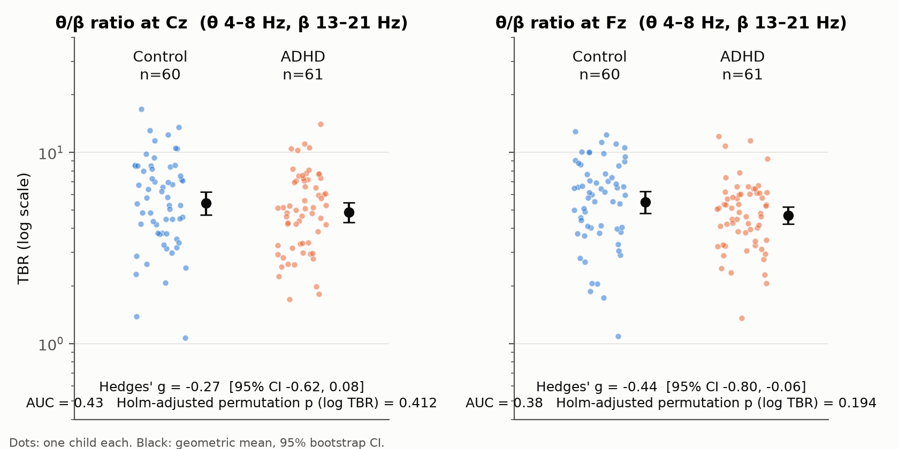
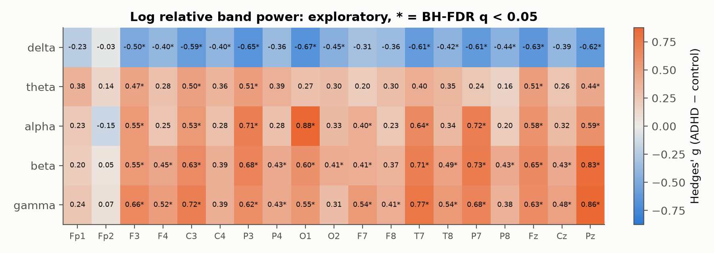
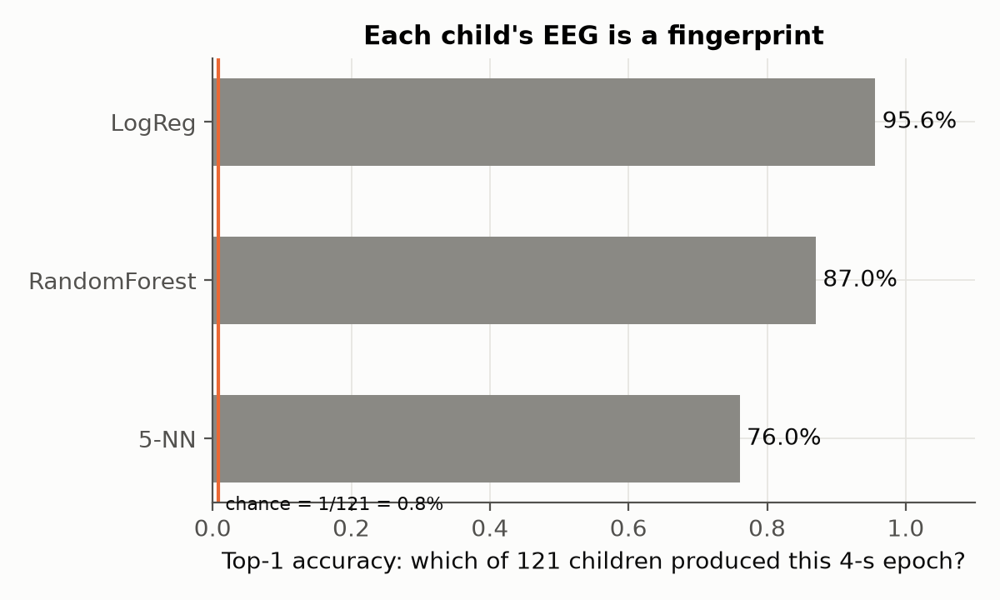
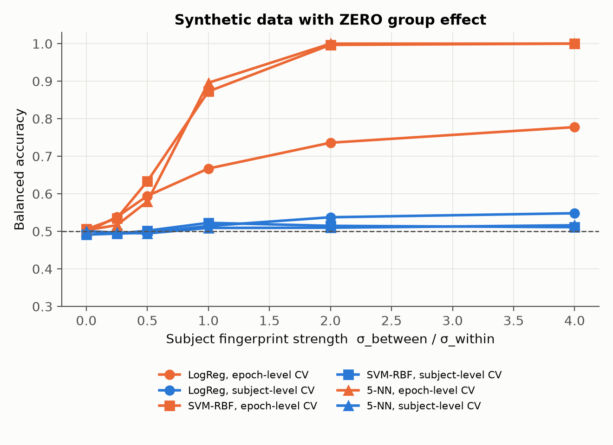
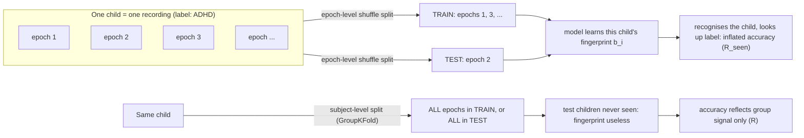

# ADHD EEG reality check

**A reproducible audit of two popular claims in ADHD EEG research, on open data:**

1. *"The theta/beta ratio (TBR) is an EEG biomarker of ADHD."*
2. *"Machine learning classifies ADHD from EEG with 95–99% accuracy."*

Every number below comes from the scripts in this repository and can be regenerated
with four commands. Nothing here is a diagnostic tool (see [What this does NOT claim](#what-this-does-not-claim)).

[](.github/workflows/ci.yml)

---

## TL;DR

| Question | Result on 121 children (61 ADHD, 60 controls) |
|---|---|
| Is TBR at Cz higher in ADHD? | **No.** Hedges' $g = -0.27$, 95% CI $[-0.62,\ 0.08]$, AUC $= 0.43$ (lower in ADHD, not significant). The literature's pooled estimate, $g \approx 0.62$, lies outside this CI. |
| Leaky epoch-level CV accuracy | 0.76–0.90 per epoch, **0.84–0.97 per child** after majority vote |
| Same features, same models, subject-level CV | **0.59–0.63** per epoch, 0.63–0.67 per child |
| Epoch-level CV with diagnoses **randomly shuffled between children** | **0.71–0.88**: high "accuracy" when the labels carry no ADHD information at all |
| Which child produced a given 4-second epoch? (121-way) | **95.6%** top-1 accuracy (chance: 0.8%) |
| TBR alone as a classifier, subject-level CV | 0.52 (chance level) |

The inflation comes from the epoch-level split itself, not from the features. Each child's EEG works like a fingerprint. When the
same child's epochs land in both the training set and the test set, a classifier can score well by
recognising *who* the child is and looking up their label. It doesn't need to learn anything about *ADHD*.

---

## Data

**EEG data for ADHD / Control children.** Nasrabadi, Allahverdy, Samavati & Mohammadi (2020),
IEEE DataPort, [doi:10.21227/rzfh-zn36](https://doi.org/10.21227/rzfh-zn36).
License: **CC BY 4.0** (per the DataCite record of the DOI).

- 61 children with ADHD (DSM-IV, psychiatrist-diagnosed; some had taken methylphenidate for up to 6 months)
  and 60 controls, aged 7–12.
- 19 channels (10-20 system), 128 Hz, linked-ear reference (A1/A2).
- **Task, not rest.** The children counted cartoon characters in a series of images. Each image appeared as soon as the child answered the previous one,
  so how long a recording lasts depends on the child's speed: 62–338 s here, median 130 s.

**Download.** The official copy needs a free IEEE DataPort login. `scripts/fetch_data.py` does either of the following:

- extracts the four official zips if you put them in `data/official/`, or
- downloads the same 121 `.mat` files from a public GitHub mirror pinned to a fixed commit, and checks **every
  file** against the git blob SHA-1 listed in [`data/manifest.txt`](data/manifest.txt). Before pinning the manifest, I compared it with
  a second, independent mirror: all 121 hashes were identical.

This repository does **not** redistribute the raw data. It only contains derived per-child summary values
(`results/tbr_per_subject.csv`).

**Channel order check.** Some papers list the channels in a different order. The
`Channel_Labels` file that ships with the dataset gives
`Fp1 Fp2 F3 F4 C3 C4 P3 P4 O1 O2 F7 F8 T7 T8 P7 P8 Fz Cz Pz`. The data agree with that order
(`results/summary.json`, `channel_sanity`):

- The two channels with the most 0.5–3 Hz power are Fp1 and Fp2, which is what eye blinks produce.
- Every channel's most-correlated partner is a scalp neighbour (Fp1–F3, O2–P4, Fz–F3, …).

## Reproduce

```bash
python -m venv .venv && source .venv/bin/activate
pip install -e ".[test]"
python scripts/fetch_data.py      # 33 MB, hash-verified
python scripts/run_audit.py       # ~20–40 min, single core, < 300 MB RAM
python scripts/simulate.py        # synthetic leakage sweep (~1 min)
python scripts/icc.py             # intraclass correlation of features
python scripts/make_figures.py
python scripts/verify_dois.py     # checks every DOI in this README on Crossref/DataCite
pytest -q                         # unit tests + synthetic leakage verifier (no data needed)
```

Every analysis runs with `n_jobs=1` and keeps one recording in memory at a time. All random seeds are fixed. Two
complete runs from scratch gave byte-identical `results/*.json`.

---

## Methods

### Pre-processing and spectra

Each recording is split into non-overlapping 4-s epochs. The power spectral density of each epoch and channel is estimated with
Welch's method (Hann window, $L = 256$ samples = 2 s, 50% overlap, so $\Delta f = 0.5$ Hz):

$$
\hat S(f) \;=\; \frac{1}{K}\sum_{k=1}^{K} \frac{1}{f_s \sum_n w[n]^2}\,\Bigl|\sum_{n=0}^{L-1} w[n]\,\bigl(x_k[n]-\bar x_k\bigr)\,e^{-i 2\pi f n / f_s}\Bigr|^2 ,
$$

where $x_k$ is the $k$-th segment and $w$ the window (one-sided spectrum, so the non-DC bins are doubled).

**Artifact rejection** is unit-free and done separately for each child, because the files don't document their amplitude scale.
For every epoch and channel I take $\ell = \log \sum_{f\in[1,40)} \hat S(f)$. An epoch is dropped if, on any channel, its
robust z-score $|\ell - \mathrm{median}| / (1.4826\cdot\mathrm{MAD})$ exceeds 3.5. That rejects 687 of 4,173 epochs and keeps 3,486 (83.5%).
There is no ICA and no EOG regression. This is deliberate: it keeps the pipeline simple and auditable, and the limitations section discusses the cost.

### Theta/beta ratio

Band power is $P_{[a,b)} = \Delta f \sum_{f\in[a,b)} \hat S(f)$. For each child, the PSD is averaged over the clean epochs first, and the ratio is taken after that:

$$
\mathrm{TBR}_{c} \;=\; \frac{P^{(c)}_{[4,8)}}{P^{(c)}_{[13,21)}}\qquad c\in\{\mathrm{Cz},\mathrm{Fz}\}
$$

The 13–21 Hz beta band is the one used in much of the TBR literature. The "broad" variant uses 13–30 Hz.

### Effect size and inference

ADHD minus control, Hedges' $g$ with the exact small-sample correction:

$$
g \;=\; J(\nu)\,\frac{\bar x_{\mathrm{ADHD}}-\bar x_{\mathrm{C}}}{s_p},\qquad
s_p^2=\frac{(n_A-1)s_A^2+(n_C-1)s_C^2}{n_A+n_C-2},\qquad
J(\nu)=\frac{\Gamma(\nu/2)}{\sqrt{\nu/2}\;\Gamma\!\left(\frac{\nu-1}{2}\right)},\ \nu=n_A+n_C-2 .
$$

- **95% CIs:** BCa bootstrap, 10,000 resamples, each group resampled separately.
- **p-values:** two-sided permutation tests on the difference in means of $\log_{10}\mathrm{TBR}$, 10,000 permutations.
- **Primary family** (TBR × {Cz, Fz} × {13–21, 13–30 Hz}, 4 tests): Holm correction.
- **Exploratory family** (log relative power, 5 bands × 19 channels = 95 tests): Benjamini–Hochberg FDR.
- **AUC:** $\Pr(\mathrm{TBR}_{\mathrm{ADHD}} > \mathrm{TBR}_{\mathrm{C}})$, which is what TBR would deliver if you used it on its own as a diagnostic score.
- **Power:** with $n = 61/60$, the minimum detectable effect at 80% power and $\alpha = .05$ is $|g| \approx 0.51$.

### Classification

- **Features per epoch (97):** $\log_{10}$ relative power (delta 1–4, theta 4–8, alpha 8–13, beta 13–30 and gamma 30–40 Hz, divided by 1–40 Hz power) on all 19 channels, plus $\log_{10}\mathrm{TBR}$ at Fz and Cz.
- **Models (scikit-learn):** logistic regression, RBF-SVM, random forest (300 trees) and 5-nearest-neighbours. The linear and distance-based models get standardised inputs.
- **Two cross-validation schemes, 5 folds each, repeated over 5 seeds.** The data, features and models are identical in both. Only the split changes:
  - **epoch-level:** `StratifiedKFold` on epochs (the leaky one),
  - **subject-level:** `StratifiedGroupKFold` with child as the group (the honest one).
- **Metrics:**
  - balanced accuracy over epochs,
  - balanced accuracy over children, where each child's label is a majority vote of their out-of-fold epoch predictions.

---

## Result 1: the theta/beta ratio



| Feature | Mean ADHD | Mean control | Hedges' $g$ [95% CI] | $g$ on log TBR [95% CI] | AUC | $p_{\text{Holm}}$ |
|---|---|---|---|---|---|---|
| TBR Cz (β 13–21) | 5.42 | 6.22 | −0.27 [−0.62, 0.08] | −0.21 [−0.57, 0.16] | 0.43 | 0.41 |
| TBR Fz (β 13–21) | 5.07 | 6.19 | −0.44 [−0.80, −0.06] | −0.34 [−0.71, 0.04] | 0.38 | 0.19 |
| TBR Cz (β 13–30) | 3.67 | 4.20 | −0.26 [−0.61, 0.10] | −0.23 [−0.58, 0.13] | 0.43 | 0.41 |
| TBR Fz (β 13–30) | 3.46 | 4.29 | −0.48 [−0.83, −0.12] | −0.39 [−0.75, −0.01] | 0.38 | 0.15 |

What the table shows:

- **No TBR variant separates the groups after correction.** All four point estimates are *negative*, meaning lower TBR in ADHD.
- **The direction is opposite to the classic hypothesis.**
- **Even at its best (Fz, AUC 0.38), TBR would misclassify far too many children** to be useful on its own.

**How this compares with the literature.** Arns, Conners & Kraemer (2013) meta-analysed eyes-open
TBR at Cz in 9 studies (1,253 children/adolescents with ADHD, 517 without):

- They found a grand-mean effect size of 0.62 for ages 6–18 and 0.75 for ages 6–13.
- The test for heterogeneity was significant, so they described these effect sizes as overestimates.
- The difference shrank across publication years, because TBR rose in the non-ADHD groups.
- They concluded that TBR "cannot be considered a reliable diagnostic measure of ADHD".

van Dijk et al. (2020) applied five spectral-analysis pipelines to the TBR. The pipelines gave significantly different ratios, but
*none* of them distinguished children with ADHD from controls.

The CI here, $[-0.62,\ 0.08]$ at Cz, excludes both 0.62 and 0.75. **This is not a replication.** These recordings come from a visual
attention task, not eyes-open rest. They are better read as a stress test: the TBR difference does not carry over to this setting.

**Regulatory context.** On 15 July 2013 the US FDA granted a De Novo request (DEN110019) for the *NEBA System*
(Lexicor Medical Technology). That decision created the device type *"neuropsychiatric interpretive electroencephalograph
assessment aid"*, Class II, 21 CFR 882.1440. The regulation defines the device as one *"used only as an assessment aid for a medical
condition for which there exists other valid methods of diagnosis"*. In other words, the regulatory status describes an
*aid* used alongside clinical diagnosis, not a stand-alone EEG test for ADHD.

### Something else differs between the groups, and that is a warning

The exploratory relative-power scan finds that **56 of 95** channel × band features differ at BH-FDR $q<0.05$
(largest: alpha at O1, $g = 0.88$). The pattern is the same almost everywhere: *less* relative delta in ADHD and *more* relative
theta, alpha, beta and gamma.



Spread this widely and with this little spatial specificity, the pattern looks more like a difference in recording conditions
or in low-frequency artifact than like focal neurophysiology. The two groups also differ in task duration: the ADHD
recordings are longer (median 144 s vs 122 s; $g = 0.64$ [0.31, 0.96]). This analysis can't tell site, session, medication or
artifact effects apart from "ADHD". Neither can any classifier trained on these data.

---

## Result 2: where the 95–99% accuracies come from


Balanced accuracy, mean ± SD over 5 seeds:

| Model | Epoch-CV, per epoch | Epoch-CV, per child (vote) | **Subject-CV, per epoch** | Subject-CV, per child (vote) | Epoch-CV with **shuffled** labels |
|---|---|---|---|---|---|
| Logistic regression | 0.760 ± 0.004 | 0.839 | **0.588 ± 0.028** | 0.626 | 0.706 |
| SVM (RBF) | 0.887 ± 0.002 | 0.952 | **0.631 ± 0.014** | 0.660 | 0.849 |
| Random forest | 0.856 ± 0.003 | 0.909 | **0.631 ± 0.009** | 0.647 | 0.838 |
| 5-NN | 0.902 ± 0.006 | **0.970** | **0.632 ± 0.002** | 0.671 | 0.876 |

What the table shows:

- **Epoch-level CV with a per-child vote lands in the 95–97% range**, which is what papers report.
- **The same pipeline evaluated on unseen children reaches 59–63%.**
- **The last column is the decisive control.** There, the ADHD/control labels were randomly reassigned *between children* (10 permutations), so they carry no diagnostic information at all.
- **Epoch-level CV still reports 71–88%.** All that accuracy is identity leakage.

**Is the honest number above chance?** For logistic regression with subject-level CV, a permutation null (200 between-child label
shuffles) has mean 0.505 and 95th percentile 0.559. The observed value is 0.588, $p = 0.010$.

So there is *some* group-related signal. Given the confounds above, I can't say how much of it is ADHD. A classifier that
uses only the two TBR features scores 0.52 under subject-level CV.

### Each child is a fingerprint



Here the classifier has to guess *which* of the 121 children produced each 4-s epoch. Scores below are top-1 accuracy under epoch-level CV:

- logistic regression: **95.6%**
- random forest: 87.0%
- 5-NN: 76.0%
- chance: 0.83%

The features are strongly subject-specific. Their intraclass correlation has a median of $\rho = 0.51$ (IQR 0.44–0.60; `results/icc.json`).

### Why epoch-level CV is wrong: a formal sketch

Write epoch $j$ of child $i$ as

$$
x_{ij} \;=\; \mu \;+\; \delta\, y_i \;+\; b_i \;+\; \varepsilon_{ij},\qquad
b_i\sim\mathcal N(0,\Sigma_b),\quad \varepsilon_{ij}\sim\mathcal N(0,\Sigma_w),
$$

where $y_i\in\{0,1\}$ is the child's diagnosis, $b_i$ is a persistent subject-specific "fingerprint" (anatomy, skull
thickness, electrode impedance, alertness, recording session) and $\delta$ is the true group effect.

**Epochs are not i.i.d.** For $j\neq j'$, $\operatorname{Cov}(x_{ij},x_{ij'}) = \Sigma_b \neq 0$. They are exchangeable only
*within* a child. The child is the unit that gets sampled from the population.

**The quantity we want** is the accuracy on a *new* child,
$R = \Pr\bigl[h(x_{\ast j}) = y_\ast\bigr]$, where the new child $\ast$ is not among the training children $\mathcal S_{\text{train}}$.

**What K-fold CV on epochs estimates instead.** It almost always leaves the test child's other epochs in the training set, so it estimates

$$
R_{\text{seen}} \;=\; \Pr\bigl[h(x_{ij}) = y_i \,\big|\, i \in \mathcal S_{\text{train}}\bigr].
$$

**Why $R_{\text{seen}}$ can be large when there is no effect at all.** Within a child the label is constant ($y_{ij}=y_i$). Let $\hat\imath(x)$ be any
subject identifier and $h(x)=y_{\hat\imath(x)}$ the "label lookup" built on top of it. Then

$$
R_{\text{seen}}(h) \;\ge\; \Pr\bigl[\hat\imath(x_{ij}) = i\bigr],
$$

and this bound holds *whatever the value of $\delta$*. When $\delta = 0$, $y_\ast$ is independent of $x_{\ast j}$, so $R = 1/2$ for
every $h$ (balanced classes). Meanwhile $R_{\text{seen}}$ can approach 1 as soon as
$\operatorname{tr}\Sigma_b \gg \operatorname{tr}\Sigma_w$.

On these data $\Pr[\hat\imath(x)=i] = 0.956$ for logistic regression, so 95%+ "diagnostic" accuracy is within
reach without any ADHD signal.

**There are far fewer independent samples than epochs.** With $m$ epochs per child and intraclass correlation $\rho$,
the design effect is $1+(m-1)\rho$. Here $m \approx 28.8$ and $\rho \approx 0.51$, so 3,486 epochs carry about as much
information as **≈ 231 independent observations**. And for any question about *children*, the relevant $n$ is 121.

The synthetic experiment below sets $\delta = 0$ exactly and varies $\sigma_b/\sigma_w$:



- **Epoch-level CV** climbs from 0.5 to 1.0 as the fingerprint gets stronger.
- **Subject-level CV** stays at chance.

The test suite asserts exactly this behaviour (`tests/test_core.py::test_epoch_cv_inflates_under_null`).

### How leakage happens



---

## What this does NOT claim

- **This is not a diagnostic tool.** Nothing in this repository should be used to screen, diagnose or rule out ADHD
  in anyone. ADHD is a clinical diagnosis made by qualified clinicians from history, multiple informants and
  established criteria.
- **It does not claim that EEG carries no information about ADHD.** On *this* dataset, an honest subject-level
  evaluation gives modest above-chance accuracy, and its source (ADHD, medication, task duration, recording conditions) can't be identified.
- **It does not claim that TBR is "debunked" in general.** This is one dataset of 121 children, recorded during a task,
  from one population, with no eyes-open resting condition, no ICA, no age or sex covariates (they aren't in the files),
  and partly medicated children. The finding is narrower: here, TBR does not separate the groups, and the CI excludes the
  effect sizes pooled by older meta-analyses.
- **It does not claim that any specific published paper used epoch-level CV.** It shows, quantitatively, how large the
  inflation is when anyone does.

## Limitations

- **One dataset**, task-based EEG, 128 Hz, unknown amplitude scaling, no demographics, unknown recording order or sites.
- **Simple artifact handling** (robust per-child epoch rejection only). Ocular and EMG artifacts can bias relative power,
  especially at frontal sites and in the delta and gamma bands.
- **Mirror-based download.** The files were checked against two independent mirrors, but not against the official zips
  (those need a login). Users who have the official zips can put them in `data/official/`.
- **Different task durations between groups** are a confound I can document but not remove.
- **No hyperparameter tuning.** This is intentional: tuning with nested subject-level CV would not change the leakage conclusion.
  Absolute subject-level accuracies may move by a few points with tuning.

## Why I built this

<!-- TODO(Tommaso): dictate 3-4 lines in your own words -->

## References

All DOIs were checked against Crossref (or DataCite for the dataset) with `scripts/verify_dois.py`; output is in `results/doi_check.tsv`.

- Arns, M., Conners, C. K., & Kraemer, H. C. (2013). A decade of EEG theta/beta ratio research in ADHD: a meta-analysis.
  *Journal of Attention Disorders*, 17(5), 374–383. https://doi.org/10.1177/1087054712460087
- van Dijk, H., deBeus, R., Kerson, C., Roley-Roberts, M. E., Monastra, V. J., Arnold, L. E., Pan, X., & Arns, M. (2020).
  Different spectral analysis methods for the theta/beta ratio calculate different ratios but do not distinguish ADHD
  from controls. *Applied Psychophysiology and Biofeedback*, 45(3), 165–173. https://doi.org/10.1007/s10484-020-09471-2
- Saad, J. F., Kohn, M. R., Clarke, S., Lagopoulos, J., & Hermens, D. F. (2018). Is the theta/beta EEG marker for ADHD
  inherently flawed? *Journal of Attention Disorders*, 22(9), 815–826. https://doi.org/10.1177/1087054715578270
- Lenartowicz, A., & Loo, S. K. (2014). Use of EEG to diagnose ADHD. *Current Psychiatry Reports*, 16(11), 498.
  https://doi.org/10.1007/s11920-014-0498-0
- US FDA. De Novo DEN110019, NEBA System, decision date 2013-07-15. https://www.accessdata.fda.gov/scripts/cdrh/cfdocs/cfpmn/denovo.cfm?ID=DEN110019 ;
  21 CFR 882.1440. https://www.ecfr.gov/current/title-21/section-882.1440
- Saeb, S., Lonini, L., Jayaraman, A., Mohr, D. C., & Kording, K. P. (2017). The need to approximate the use-case in
  clinical machine learning. *GigaScience*, 6(5). https://doi.org/10.1093/gigascience/gix019
- Varoquaux, G. (2018). Cross-validation failure: small sample sizes lead to large error bars. *NeuroImage*, 180, 68–77.
  https://doi.org/10.1016/j.neuroimage.2017.06.061
- Kapoor, S., & Narayanan, A. (2023). Leakage and the reproducibility crisis in machine-learning-based science.
  *Patterns*, 4(9), 100804. https://doi.org/10.1016/j.patter.2023.100804
- Brookshire, G., et al. (2024). Data leakage in deep learning studies of translational EEG. *Frontiers in Neuroscience*,
  18. https://doi.org/10.3389/fnins.2024.1373515
- Welch, P. (1967). The use of fast Fourier transform for the estimation of power spectra. *IEEE Transactions on Audio
  and Electroacoustics*, 15(2), 70–73. https://doi.org/10.1109/TAU.1967.1161901
- Hedges, L. V. (1981). Distribution theory for Glass's estimator of effect size and related estimators. *Journal of
  Educational Statistics*, 6(2), 107–128. https://doi.org/10.3102/10769986006002107
- Benjamini, Y., & Hochberg, Y. (1995). Controlling the false discovery rate. *Journal of the Royal Statistical Society
  B*, 57(1), 289–300. https://doi.org/10.1111/j.2517-6161.1995.tb02031.x
- Holm, S. (1979). A simple sequentially rejective multiple test procedure. *Scandinavian Journal of Statistics*, 6(2), 65–70. (no DOI)
- Dataset: Nasrabadi, A. M., Allahverdy, A., Samavati, M., & Mohammadi, M. R. (2020). EEG data for ADHD / Control
  children. IEEE DataPort. https://doi.org/10.21227/rzfh-zn36 (CC BY 4.0)

## License

Code: MIT, © 2026 Tommaso Maggiolo. The dataset is CC BY 4.0 and belongs to its authors; it is not included here.
