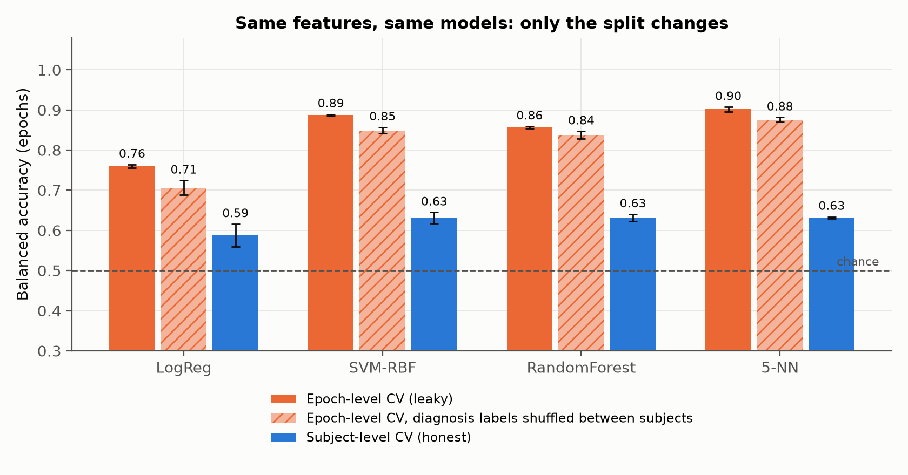

# adhd-eeg-reality-check



[](.github/workflows/ci.yml)

An audit, on 121 children from an open dataset (61 ADHD, 60 controls), of two common claims: that the theta/beta ratio is an EEG biomarker of ADHD, and that machine learning classifies ADHD from EEG with 95–99% accuracy. Here TBR at Cz is not higher in ADHD (Hedges' $g = -0.27$, 95% CI $[-0.62,\ 0.08]$). The same classifiers score 0.84–0.97 per child when epochs from one child are split across train and test, 0.63–0.67 when they aren't, and 0.71–0.88 with diagnoses randomly shuffled between children.

<!-- TODO(Tommaso): dictate 3-4 lines in your own words -->

This is not a diagnostic tool, and nothing here should be used to screen for or rule out ADHD.

## Reproduce

```bash
python -m venv .venv && source .venv/bin/activate
pip install -e ".[test]"
python scripts/fetch_data.py      # 33 MB, hash-verified
python scripts/run_audit.py       # ~20–40 min, single core, < 300 MB RAM
python scripts/simulate.py        # synthetic leakage sweep (~1 min)
python scripts/icc.py             # intraclass correlation of features
python scripts/make_figures.py
python scripts/verify_dois.py     # checks every DOI in this README on Crossref/DataCite
pytest -q                         # unit tests + synthetic leakage verifier (no data needed)
```

Seeds are fixed and two runs from scratch gave byte-identical `results/*.json`.

The data is Nasrabadi et al. (2020), IEEE DataPort, [doi:10.21227/rzfh-zn36](https://doi.org/10.21227/rzfh-zn36), CC BY 4.0: children aged 7–12, 19 channels at 128 Hz, linked-ear reference. It is a task recording, not rest. The children counted cartoon characters in images, so recordings run 62–338 s (median 130 s). Some ADHD children had taken methylphenidate for up to 6 months. The official copy needs a login, so `fetch_data.py` either extracts the official zips from `data/official/` or downloads a pinned public mirror and checks every file against [`data/manifest.txt`](data/manifest.txt); a second independent mirror gave all 121 identical hashes. The raw data is not redistributed. Channel order (`Fp1 Fp2 F3 F4 C3 C4 P3 P4 O1 O2 F7 F8 T7 T8 P7 P8 Fz Cz Pz`) was checked against the data: Fp1 and Fp2 carry the most 0.5–3 Hz blink power, and every channel's most-correlated partner is a scalp neighbour.

## The theta/beta ratio

Each recording is cut into 4-s epochs, Welch PSD (2 s Hann, 50% overlap, $\Delta f = 0.5$ Hz). Because the amplitude scale is undocumented, rejection is unit-free and per child: an epoch goes if, on any channel, $\ell = \log \sum_{f\in[1,40)} \hat S(f)$ has a robust z-score above 3.5. That keeps 3,486 of 4,173 epochs (83.5%). The PSD is averaged per child before taking

$$
\mathrm{TBR}_{c} \;=\; \frac{P^{(c)}_{[4,8)}}{P^{(c)}_{[13,21)}}\qquad c\in\{\mathrm{Cz},\mathrm{Fz}\},
$$

with 13–30 Hz as the broad-beta variant. Effects are ADHD minus control, Hedges' $g$ with the exact small-sample correction $J(\nu)$, BCa bootstrap CIs (10,000 resamples) and permutation p-values on $\log_{10}\mathrm{TBR}$, Holm-corrected over the 4 TBR tests. With 61/60 children the minimum detectable effect at 80% power is $|g| \approx 0.51$.

All four variants point the wrong way, lower in ADHD, and none survives correction. At Cz (13–21 Hz) the means are 5.42 vs 6.22, AUC 0.43, $p_{\text{Holm}} = 0.41$. The strongest is Fz with 13–30 Hz beta, $g = -0.48$ $[-0.83, -0.12]$, AUC 0.38, $p_{\text{Holm}} = 0.15$. Arns, Conners & Kraemer (2013) pooled 0.62 for ages 6–18 and 0.75 for ages 6–13, and the Cz CI here excludes both. This is a task recording, so it is not a replication; it says the difference doesn't carry over to this setting. The FDA's 2013 De Novo for the NEBA System (DEN110019, 21 CFR 882.1440) cleared it only as an assessment aid alongside clinical diagnosis.

Something else does differ. 56 of 95 channel × band relative-power features differ at BH-FDR $q<0.05$ (largest: alpha at O1, $g = 0.88$), with less relative delta in ADHD and more of everything else, almost everywhere on the scalp. That looks more like recording conditions or low-frequency artifact than focal neurophysiology. ADHD recordings are also longer (median 144 s vs 122 s; $g = 0.64$ [0.31, 0.96]). Any classifier trained on this data inherits those confounds.

## Where 95–99% comes from

97 features per epoch: $\log_{10}$ relative power in 5 bands on 19 channels, plus $\log_{10}\mathrm{TBR}$ at Fz and Cz. Same features and models under two 5-fold schemes over 5 seeds; only the split changes. Epoch-level uses `StratifiedKFold` on epochs. Subject-level uses `StratifiedGroupKFold` with the child as group. Balanced accuracy, mean ± SD:

| Model | Epoch-CV, per epoch | Epoch-CV, per child (vote) | Subject-CV, per epoch | Subject-CV, per child (vote) | Epoch-CV, shuffled labels |
|---|---|---|---|---|---|
| Logistic regression | 0.760 ± 0.004 | 0.839 | 0.588 ± 0.028 | 0.626 | 0.706 |
| SVM (RBF) | 0.887 ± 0.002 | 0.952 | 0.631 ± 0.014 | 0.660 | 0.849 |
| Random forest | 0.856 ± 0.003 | 0.909 | 0.631 ± 0.009 | 0.647 | 0.838 |
| 5-NN | 0.902 ± 0.006 | 0.970 | 0.632 ± 0.002 | 0.671 | 0.876 |

The last column reassigns labels between children (10 permutations), so they carry no diagnostic information, and epoch-level CV still reports 71–88%. That's identity leakage. Asked which of the 121 children produced a 4-s epoch, logistic regression gets 95.6% top-1 (chance 0.83%). The honest number is above chance: for logistic regression under subject-level CV, 200 between-child shuffles give a null mean of 0.505 and 95th percentile 0.559, against an observed 0.588 ($p = 0.010$). Given the confounds above I can't say how much of that is ADHD. TBR alone scores 0.52.

Write epoch $j$ of child $i$ as

$$
x_{ij} \;=\; \mu \;+\; \delta\, y_i \;+\; b_i \;+\; \varepsilon_{ij},\qquad
b_i\sim\mathcal N(0,\Sigma_b),\quad \varepsilon_{ij}\sim\mathcal N(0,\Sigma_w),
$$

with $y_i$ the diagnosis, $\delta$ the true group effect and $b_i$ a persistent per-child fingerprint (anatomy, impedance, alertness, session). Epochs of one child share covariance $\Sigma_b$, so the child is the sampled unit and what we want is accuracy on a new child, $R$. Epoch-level CV almost always leaves the test child's other epochs in training, so it estimates $R_{\text{seen}}$ instead. Since the label is constant within a child, a subject identifier $\hat\imath$ plus label lookup $h(x) = y_{\hat\imath(x)}$ gives

$$
R_{\text{seen}}(h) \;\ge\; \Pr\bigl[\hat\imath(x_{ij}) = i\bigr]
$$

for any $\delta$. At $\delta = 0$, $R = 1/2$ for every $h$, yet $R_{\text{seen}}$ approaches 1 once $\operatorname{tr}\Sigma_b \gg \operatorname{tr}\Sigma_w$. Here $\Pr[\hat\imath(x)=i] = 0.956$. The feature ICC has median $\rho = 0.51$ (IQR 0.44–0.60), so with $m \approx 28.8$ epochs per child the design effect $1+(m-1)\rho$ shrinks 3,486 epochs to ≈ 231 independent observations, and for questions about children the relevant $n$ is 121. A synthetic sweep with $\delta = 0$ exactly ([`fig5`](figures/fig5_synthetic_leakage.png)) shows epoch-level CV climbing from 0.5 to 1.0 as $\sigma_b/\sigma_w$ grows while subject-level CV stays at chance; `tests/test_core.py::test_epoch_cv_inflates_under_null` asserts it.

## Limitations

- One dataset, task EEG, 128 Hz, unknown amplitude scaling, no demographics (no age or sex covariates), unknown recording order or sites, partly medicated children.
- Artifact handling is per-child epoch rejection only, no ICA or EOG regression. Ocular and EMG artifacts can bias relative power, especially frontally and in delta and gamma.
- Files were checked against two independent mirrors, not the official zips.
- Task duration differs between groups. Documented, not removed.
- No hyperparameter tuning. Absolute subject-level accuracies may move a few points; the leakage conclusion wouldn't.
- It doesn't show that EEG carries no ADHD information, that TBR is wrong in general, or that any specific paper used epoch-level CV. It shows how big the inflation is when someone does.

## References

All DOIs were checked against Crossref (or DataCite for the dataset) with `scripts/verify_dois.py`; output is in `results/doi_check.tsv`.

- Arns, M., Conners, C. K., & Kraemer, H. C. (2013). A decade of EEG theta/beta ratio research in ADHD: a meta-analysis.
  *Journal of Attention Disorders*, 17(5), 374–383. https://doi.org/10.1177/1087054712460087
- van Dijk, H., deBeus, R., Kerson, C., Roley-Roberts, M. E., Monastra, V. J., Arnold, L. E., Pan, X., & Arns, M. (2020).
  Different spectral analysis methods for the theta/beta ratio calculate different ratios but do not distinguish ADHD
  from controls. *Applied Psychophysiology and Biofeedback*, 45(3), 165–173. https://doi.org/10.1007/s10484-020-09471-2
- Saad, J. F., Kohn, M. R., Clarke, S., Lagopoulos, J., & Hermens, D. F. (2018). Is the theta/beta EEG marker for ADHD
  inherently flawed? *Journal of Attention Disorders*, 22(9), 815–826. https://doi.org/10.1177/1087054715578270
- Lenartowicz, A., & Loo, S. K. (2014). Use of EEG to diagnose ADHD. *Current Psychiatry Reports*, 16(11), 498.
  https://doi.org/10.1007/s11920-014-0498-0
- US FDA. De Novo DEN110019, NEBA System, decision date 2013-07-15. https://www.accessdata.fda.gov/scripts/cdrh/cfdocs/cfpmn/denovo.cfm?ID=DEN110019 ;
  21 CFR 882.1440. https://www.ecfr.gov/current/title-21/section-882.1440
- Saeb, S., Lonini, L., Jayaraman, A., Mohr, D. C., & Kording, K. P. (2017). The need to approximate the use-case in
  clinical machine learning. *GigaScience*, 6(5). https://doi.org/10.1093/gigascience/gix019
- Varoquaux, G. (2018). Cross-validation failure: small sample sizes lead to large error bars. *NeuroImage*, 180, 68–77.
  https://doi.org/10.1016/j.neuroimage.2017.06.061
- Kapoor, S., & Narayanan, A. (2023). Leakage and the reproducibility crisis in machine-learning-based science.
  *Patterns*, 4(9), 100804. https://doi.org/10.1016/j.patter.2023.100804
- Brookshire, G., et al. (2024). Data leakage in deep learning studies of translational EEG. *Frontiers in Neuroscience*,
  18. https://doi.org/10.3389/fnins.2024.1373515
- Welch, P. (1967). The use of fast Fourier transform for the estimation of power spectra. *IEEE Transactions on Audio
  and Electroacoustics*, 15(2), 70–73. https://doi.org/10.1109/TAU.1967.1161901
- Hedges, L. V. (1981). Distribution theory for Glass's estimator of effect size and related estimators. *Journal of
  Educational Statistics*, 6(2), 107–128. https://doi.org/10.3102/10769986006002107
- Benjamini, Y., & Hochberg, Y. (1995). Controlling the false discovery rate. *Journal of the Royal Statistical Society
  B*, 57(1), 289–300. https://doi.org/10.1111/j.2517-6161.1995.tb02031.x
- Holm, S. (1979). A simple sequentially rejective multiple test procedure. *Scandinavian Journal of Statistics*, 6(2), 65–70. (no DOI)
- Dataset: Nasrabadi, A. M., Allahverdy, A., Samavati, M., & Mohammadi, M. R. (2020). EEG data for ADHD / Control
  children. IEEE DataPort. https://doi.org/10.21227/rzfh-zn36 (CC BY 4.0)

Code: MIT, © 2026 Tommaso Maggiolo. The dataset is CC BY 4.0 and belongs to its authors; it is not included here.
